# Aula10 - BackEnd de registros de usos de IA utilizando a automação por IA

### Descrição do projeto: <br>
O SESI precisa de um sistema para registrar equipamentos ou locais e acompanhar o consumo energético, identificando possíveis desperdícios.<hr>
- script.sql
```MYSQL
drop database if exists gestao_energia;
create database gestao_energia;
use gestao_residuos;
-- DDL Criação das tabelas
create table usuario (
    id int not null auto_increment primary key,
    nome varchar(100) not null,
    email varchar(100) not null unique,
    senha varchar(100) not null
);
create table consumo (
    id int not null auto_increment primary key,
    usuarioId int not null,
    local varchar(100) not null,
    equipamento varchar(50) not null,
    consumoKwh decimal(10,2) not null,
    mesReferencia varchar(15) not null,
    status enum('Baixo','Normal','Elevado') default('Baixo') not null
);
alter table consumo add constraint fk_registra
foreign key (usuarioId) references usuario(id);

-- DML para inserir dados de exemplo nas tabelas
insert into usuario (nome, email, senha) values
('Jacinto Penna', 'jacinto@email.com', password('senha123')),
('Fujiro Nakombi', 'fujiro@email.com', password('senha123')),
('Lindo Omar', 'lindo@email.com', password('senha123'));

insert into consumo(usuarioId, local, equipamento, consumoKwh, mesReferencia, status) values
(1,'Sala de aula do 1 ano B','Ar condicionado', 185.4,'2026-09','Elevado'),
(1,'Sala de aula do 1 ano B','Projetor multimidia', 85.4,'2026-09','Normal'),
(2,'Sala de aula do 1 ano B','Computador do professor', 45.1,'2026-09','Baixo'),
(2,'Sala de aula do 1 ano A','Ar condicionado', 190.1,'2026-09','Elevado'),
(3,'Sala de aula do 1 ano A','Projetor multimidia', 86.1,'2026-09','Normal');

select * from usuario;
select * from consumo;
show tables;
```

## Método para testar o projeto:
- 1 Clone o repositório
- 2 Abra com VsCode
- 3 Em um teminal CMD ou BASH, digite:
```
npm install
npm run dev
```
- 4 Teste as rotas com a extensão Thunder Client do VsCode ou Insomnia

## Tecnologias:
- VsCode
- Node.js
- JavaScript
- JSON
- Insomnia

## Rotas - Usuários

| Método | Rota | Descrição |
| :--- | :--- | :--- |
| **GET** | `/usuarios` | Retorna a lista de usuários. |
| **GET** | `/usuarios/:id` | Retorna um usuário específico pelo ID. |
| **POST** | `/usuarios` | Cadastra um novo usuário com auto increment. |
| **PUT** | `/usuarios/:id` | Atualiza as informações de um usuário pelo ID. |
| **DELETE** | `/usuarios/:id` | Remove o usuário referente ao ID. |
| **POST** | `/usuarios/login` | Faz o login do usuário. |

## Rotas - Consumo

| Método | Rota | Descrição |
| :--- | :--- | :--- |
| **GET** | `/consumo` | Retorna a lista de registros de consumo. |
| **GET** | `/consumo/:id` | Retorna um registro de consumo específico pelo ID. |
| **GET** | `/consumo/resumo` (ou `/consumo/media`) | Retorna o resumo com a média de consumo em kWh (RF004). |
| **POST** | `/consumo` | Cadastra um novo registro de consumo com auto increment. |
| **PUT** | `/consumo/:id` | Atualiza as informações de um registro de consumo pelo ID. |
| **DELETE** | `/consumo/:id` | Remove o registro de consumo referente ao ID. |

## Exemplos de requisição e testes com o Insomnia

- ### Listar todos os usuários:
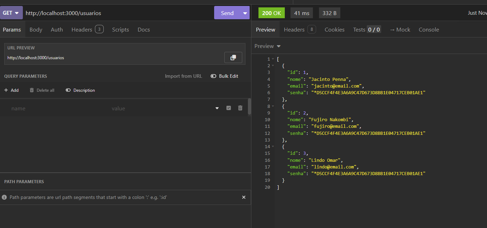

- ### Buscar usuário por ID:
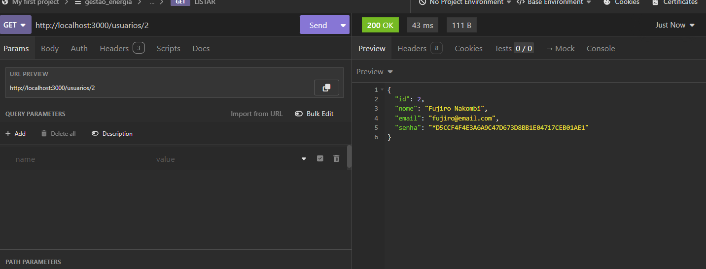

- ### Cadastrar um novo usuário:
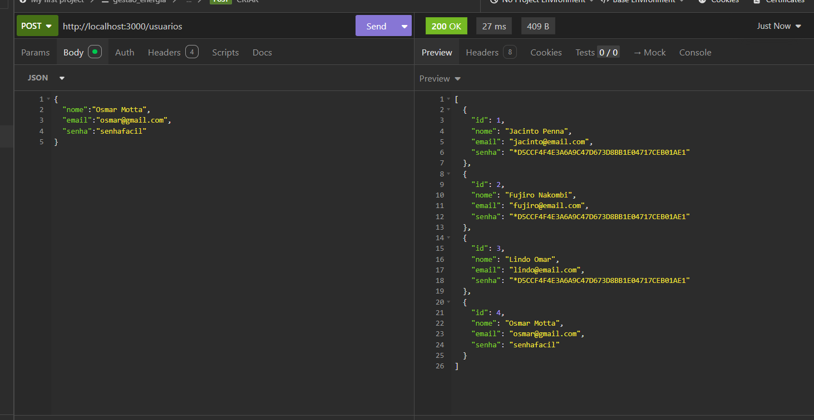

- ### Atualizar informações de um usuário:
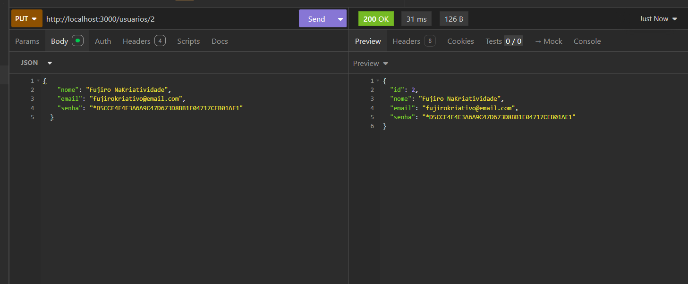

- ### Remover um usuário:
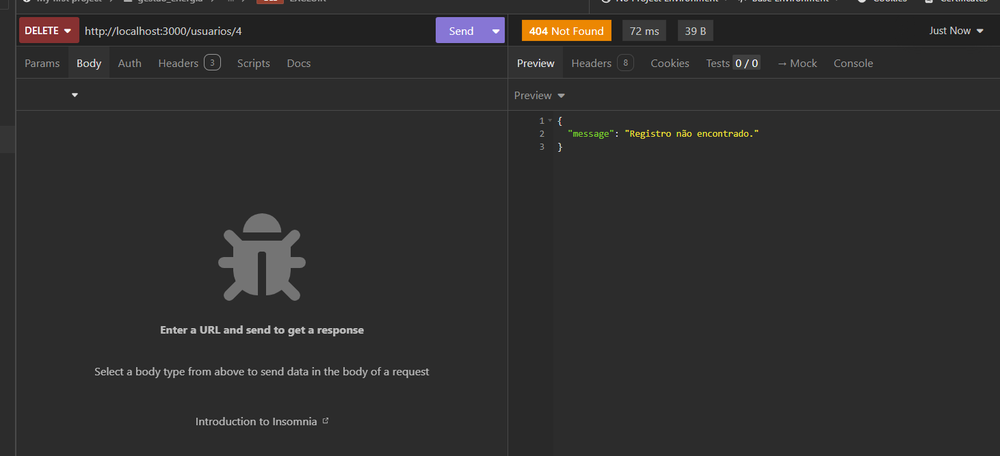

- ### Login realizado com sucesso:
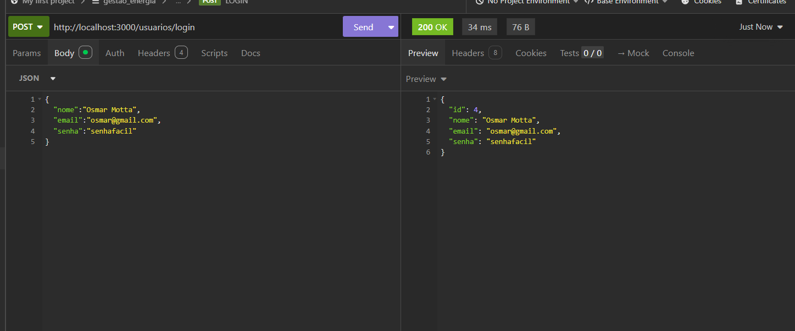

- ### Login negado:
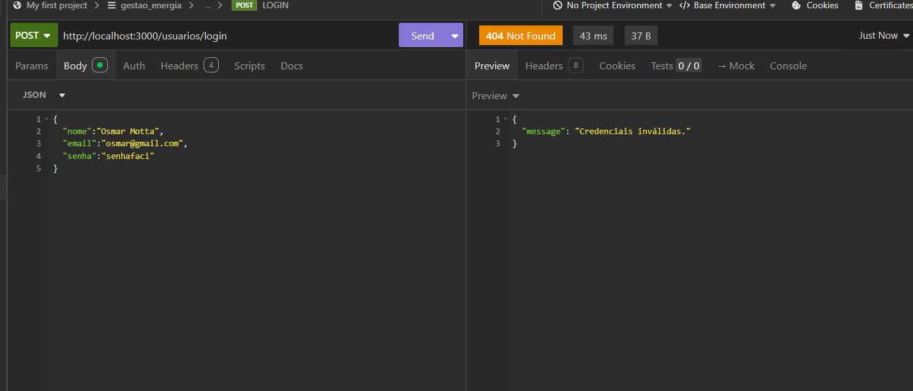

- ### Listar todos os registros de consumo:
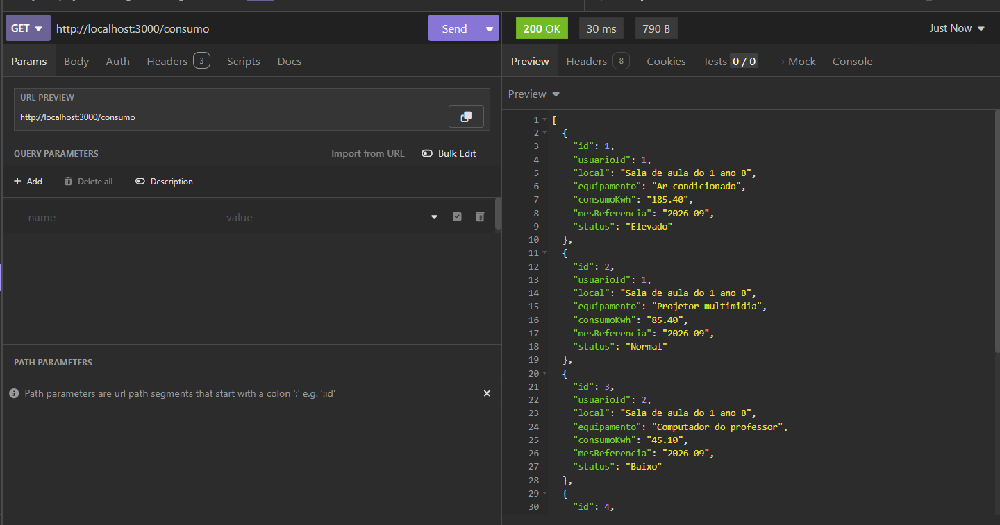

- ### Cadastrar um novo registro de consumo:
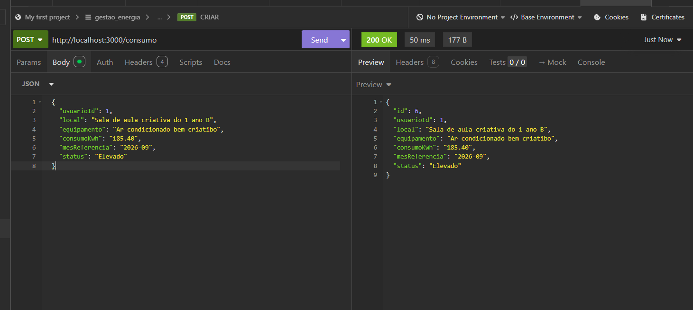

- ### Atualizar um registro de consumo:
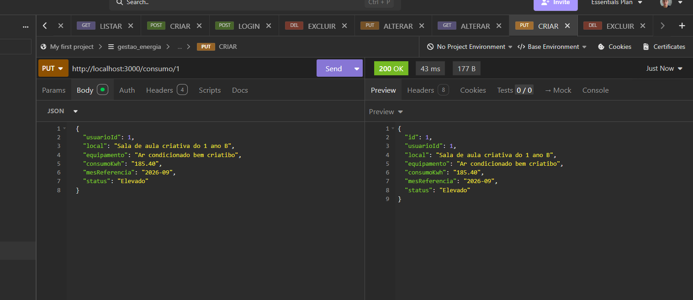

- ### Remover um registro de consumo:
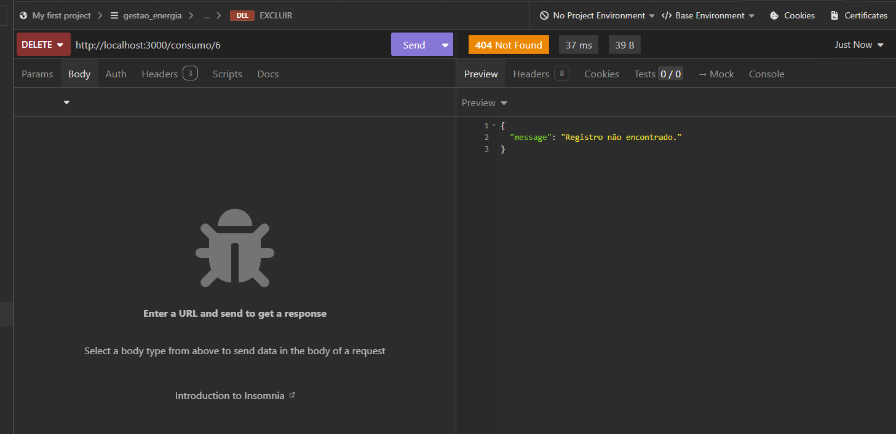

- ### Resumo / Média de consumo em kWh:
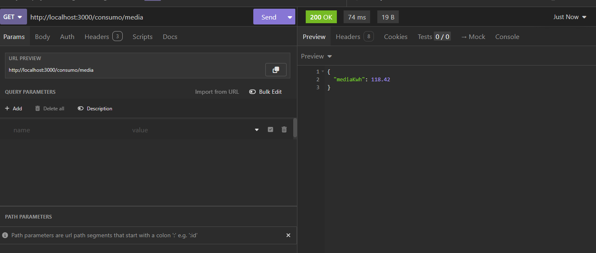

## Diagrama de classes e MER DER conceitual

- ### Diagrama de Classes:
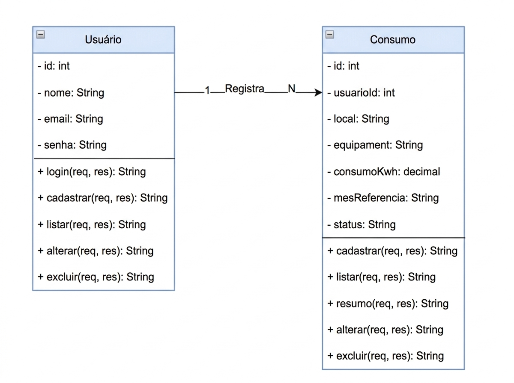

- ### MER / DER:
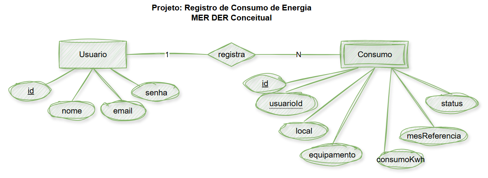
